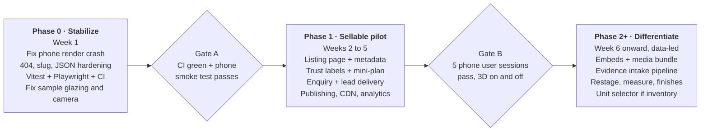

# 3dhouse — Next To-Do (Central Plan)

As of 2 November 2026. Live version: [Claude doc](https://claude.ai/artifact/LPiPk6c7Df3KN2ZPFUuapw).

## Status — 2 November 2026 (tour module)

Phase 0 is done and the tour-facing half of Phase 1 shipped (contract: `.ai-workflow/contracts/tour-module-production.md`).
Out of scope for the tour module and still open: `Listing` model, enquiry/lead flow, analytics events, CDN/KTX2, Gate B user sessions.
The tour hands off to the host listing via `meta.cta`.

## Plan at a glance

Next: spend about a week making what exists reliable (Phase 0), then build one sellable pilot listing (Phase 1). Hold new 3D features until then. This doc merges the four reviews into one backlog: Codex's [README.md](reviews/product-review.md), [production-real-estate-review.md](reviews/production-real-estate-review.md) and [image-pipeline-review.md](reviews/image-pipeline-review.md), and the tested [Claude review](https://claude.ai/artifact/WojHig4t8KDVkhgpvtR1Pd).

**Do first, in order:**

1. Fix the phone crash: N8AO `halfRes` blanks the tour on every touch device (tested).
2. Add a test harness and CI so it can't regress.
3. Harden public routes: real 404, slug check, safe JSON parsing, state reset between tours.
4. Fix the sample's structure: per Codex, the `01a` render hides the balcony glazing that the source photo shows. Fix that before polishing decor.
5. Then start the pilot listing page and enquiry flow.

**Constraints carried from the Codex docs:** no paid AI API calls; generation runs only at authoring time and the public site serves static, approved files. The tower and apartment samples are independent. Only link tower → unit → interior when real inventory data exists.

**Decide before Phase 1:** is the first customer selling one listing (agent/broker) or an off-plan project (developer)? This sets which Phase 1 items come first; see [Open decisions](#open-decisions).

## Phase roadmap

Each gate is pass/fail: nothing from the next phase starts until the previous gate passes. Decide the first customer (agent or developer) before Gate A; it sets the Phase 1 order.

## Phase 0: Stabilize (about 1 week)

Goal: the two existing samples load on phones and desktop with zero console errors, and CI blocks regressions. Every item is small; together they gate everything else.

**Runtime fixes**

- [x] Remove N8AO `halfRes` on the low tier (`src/viewer/scene/Atmosphere.tsx:72`). Accept: touch profile renders, 0 console errors; then confirm on a real iPhone and Android. *Source: Claude T1.*
- [x] Add an error boundary around the `Canvas` with a photos + facts fallback and a retry. Accept: forced WebGL failure still shows photos and a contact path. *Source: both.*
- [x] Reset `useTour` and call `narrator.stop()` on `Viewer` unmount; clear held keys on `blur` / `visibilitychange`. Accept: switching tours or tabs never carries over mode, speech or movement. *Source: both.*
- [x] Make the mode bar scroll at 390 px; replace "01a" and "window"-style ids with room names in buyer UI. *Source: Claude T5.*
- [x] Validate `?cam=` against known cameras and fall back to walk mode. *Source: both.*

**Route hardening**

- [x] Return HTTP 404 for unknown slugs (resolve before the Suspense boundary). *Source: Claude T2.*
- [x] Add the `SLUG` regex to `src/server/house-repository.ts`; wrap `JSON.parse` in try/catch; use `Promise.allSettled` on `/`. *Source: Claude T3, T4.*
- [x] Hide validation dumps from public routes: show a friendly error with a correlation id and keep diagnostics in `/preview`. *Source: Codex.*

**Tests and CI**

- [x] Vitest unit tests for `src/domain` (compiler, validator, site-compiler) on both samples plus broken fixtures.
- [x] Playwright smoke: desktop + touch projects, assert no console errors, non-blank canvas, every hotspot and mode button works, 404 on unknown slug.
- [x] GitHub Actions: `typecheck`, `lint`, both validators, unit, smoke, `build`.

**Pipeline honesty (no code generation needed)**

- [x] *(documented in the house report — needs remodel or a floor plan)* Re-check the `dubai-1br-sample` glazing, topology and `01a` camera against the source collage. Fix or document the mismatch. *Source: Codex image review.*
- [x] Correct the runbook: the validator does not check door swing or walkway clearance, so mark those manual. *Source: Codex image review.*
- [x] Replace the fixed screenshot wait with an explicit scene-ready signal; the Playwright smoke can reuse it.

**Exit gate:** CI green on both samples; phone-profile smoke passes; sample structure matches its source photo or the gap is documented.

## Phase 1: Sellable pilot (about 3–4 weeks)

Goal: one real or realistic listing that a phone user can open from a shared link, understand, trust and enquire about. Build it on one apartment first; the tower reuses the same shell.

**1a. Listing shell (week 1)**

- [ ] `Listing` model + `ListingRepository` / `ListingService`, kept separate from scene geometry: price or "Price on request", type, locality, beds/baths, area with its definition, availability, permit number, agent, fact dates.
- [x] *(tour-module version)* Listing page: cover photo + summary first; buttons for Explore in 3D, Photos and Details; 3D loads only on intent.
- [x] Persistent property header and a back-to-details control inside both viewers.
- [x] `generateMetadata` per listing, OG image rendered from an approved camera, `RealEstateListing` JSON-LD, sitemap.

**1b. Trust and orientation (week 2)**

- [x] Media types kept visibly distinct: Actual photo / 3D reconstruction / Design idea. Per-room "estimated" labels from the validator's `est` data; no verified look for the inferred bathroom.
- [x] Room list with thumbnails + a 2D mini-plan drawn from room polygons, labelled schematic unless measured; tap a room to fade there instead of passing through walls.
- [x] Same-room "compare with original photo" toggle using existing photo-match cameras.

**1c. Enquiry (week 3)**

- [ ] "Ask a question" + "Request a visit" with listing, room or chapter, and UTM prefilled and editable; no forced form before viewing.
- [ ] `LeadService` with an injectable sink (email first, CRM later), durable storage, delivery status and spam protection; confirmation says who replies and how.
- [ ] Drone tour end card: replace "Replay" with Register interest + project details.

**1d. Publish and operate (week 4)**

- [x] *(file-backed)* Draft → review → published states with a revision id; `/preview` behind auth; corrections create a new revision.
- [x] *(minus CDN + KTX2; meshopt GLBs + `?v=` immutable URLs done)* Assets: content-hashed names, immutable cache headers, CDN, KTX2 textures + Draco/Meshopt GLBs, a load-progress bar. Current desktop payload is about 19.4 MB with `max-age=0`.
- [ ] Funnel events (listing view → tour ready → room/chapter → enquiry submit/accepted) + client/server error tracking + a lead-delivery alert.

**Exit gate:** in 5 moderated phone sessions, first-time users can name the property, find a room, tell real from illustrative, and send an enquiry. Repeat those tasks with 3D disabled. *Test method from Codex.*

## Phase 2+: Differentiate (after the pilot)

Pick from this list based on what the Phase 1 sessions and funnel data show. Each item is only worth doing if a real buyer or operator task needs it.

| Item | Why | Seen at | Effort | Source |
| --- | --- | --- | --- | --- |
| Embed + unbranded link + QR | Reach Property Finder, Bayut and agency sites | Matterport, Kuula, Pedra | S | Both |
| Publication bundle from one revision: poster, thumbnails, plan image, short clip from photo-match cameras | One approval feeds every channel | Giraffe360 | M | Both |
| Evidence intake: image manifest, contact sheet, image roles, coverage map, missing-evidence checklist (`images:prepare`, `images:audit`) | Fewer wrong rooms; asks the agent for the one missing photo | — | M | Codex |
| Format router: photos-only / 360 / plan + photos / architect model | Publish something useful even when reconstruction isn't supported | Kuula, Shapespark | M | Codex |
| Defurnish / restage toggle + finish configurator | Cheap here because furniture and materials are already data | Matterport, Maverickframe | M | Claude |
| In-tour measure tool, labelled estimated unless measured | Buyer question #1 is "will it fit" | Matterport | S | Claude |
| Feature hotspots with facts + "Ask about this" | Tour answers questions, not only moves the camera | Matterport tags, CloudPano | M | Codex |
| Reviewed property FAQ, no AI: same answer in details, FAQ and agent handoff | Consistent facts; unknown stays unknown | — | M | Codex |
| Save / share / compare + freshness dates + "report incorrect detail" | Family decisions and return visits | — | M | Codex |
| Tower → floor → unit selector with live CRM availability | Off-plan sales; only with real inventory data | Maverickframe, VisEngine | L | Both |
| Pre-rendered narration MP3 + VTT; Arabic/RTL | Consistent voice; UAE market | Property Finder | M | Both |
| Seller/agent analytics dashboard | Agents win listings with engagement numbers | Zillow Showcase | M | Claude |
| Local texture generation pilot (MFLUX or ComfyUI, one generic texture) | Only if crops/CC0 fall short; no paid API | — | S | Codex |

Deferred until there is demand: live video tours, VR headset mode, Gaussian splats, sun and view simulation, land-plot parcels.

## Open decisions

Answer the first two before Phase 1 starts; the rest can wait until their phase.

| # | Question | Options | Affects |
| --- | --- | --- | --- |
| 1 | Who is the first customer? | Agent/broker selling one listing · Developer selling an off-plan project | Phase 1 order: listing page first vs project page + unit list first |
| 2 | Is the pilot property real? | A real listing with the owner's permission · Keep the samples as demos | Fact sources, permit numbers, legal disclaimers |
| 3 | Where do leads go? | Email first · A specific CRM (HubSpot, Zoho, Salesforce) · WhatsApp | `LeadSink` adapter and delivery guarantees |
| 4 | Where is it hosted? | Vercel + CDN for `public/` · Self-hosted + object storage | Asset pipeline, caching, edge vs node runtime |
| 5 | Do listings need a database now? | Keep file-backed specs + add a small DB for listings and leads · Move everything to Postgres | Repository implementations; the services stay the same |
| 6 | Positioning claim | "3D from your listing photos, estimates clearly labelled" · Push toward measured accuracy with plans/scans as input | Marketing copy, intake requirements |
| 7 | Languages at launch | English only · English + Arabic (RTL) | Layout work, narration assets |

## Source reconciliation

The reviews agree on direction and complement each other on evidence. Codex is source-only and goes deep on buyer journeys and the image pipeline. Claude ran the app and found the runtime defects.

| Topic | Codex docs | Claude review | Merged call |
| --- | --- | --- | --- |
| Listing facts, enquiry, publishing, non-3D fallback | P0 / Release 1 | P0–P1 | Agree: Phase 1 core |
| State leaks, global keys, unknown `?cam` | Flagged as risks to reproduce | Code-verified, `?cam=zzz` tested | Agree: Phase 0 |
| Phone rendering | "Not tested" | **Tested: blank on all touch devices** (N8AO `halfRes`) | Claude only: Phase 0 #1 |
| 404 status, slug regex, malformed JSON, overflow, uncached 19.4 MB | Not covered | Tested | Claude only: Phase 0 + 1d |
| Tests and CI | Launch checklist only | 0 tests, no CI; Playwright spec proposed | Phase 0 |
| Sample fidelity (glazing hidden in `01a`), validator overclaims in runbook | Found | Not covered | Codex only: Phase 0 |
| Evidence index, coverage, missing-evidence checklist, format router | Detailed design | Not covered | Codex only: Phase 2 |
| Paid AI | No paid API; local-only optional generation | Not discussed | Adopt Codex constraint |
| Tower → unit link | Only when real inventory exists | Proposed as P2 feature | Adopt Codex condition |
| Competitors | 7 products from official help pages; no vendor uplift figures | 9 products incl. Dubai (Bayut, Kuula on Property Finder, VisEngine/Azizi); Zillow's self-reported uplift | Union of both; uplift numbers are vendor claims, not targets |
| Success metrics | Task-based user sessions; no invented targets | Funnel events | Use both: sessions gate Phase 1, events track after |

The Codex docs live in the untracked `docs/` folder. Commit them, or link this plan from `docs/README.md`, so the backlog has one home.
