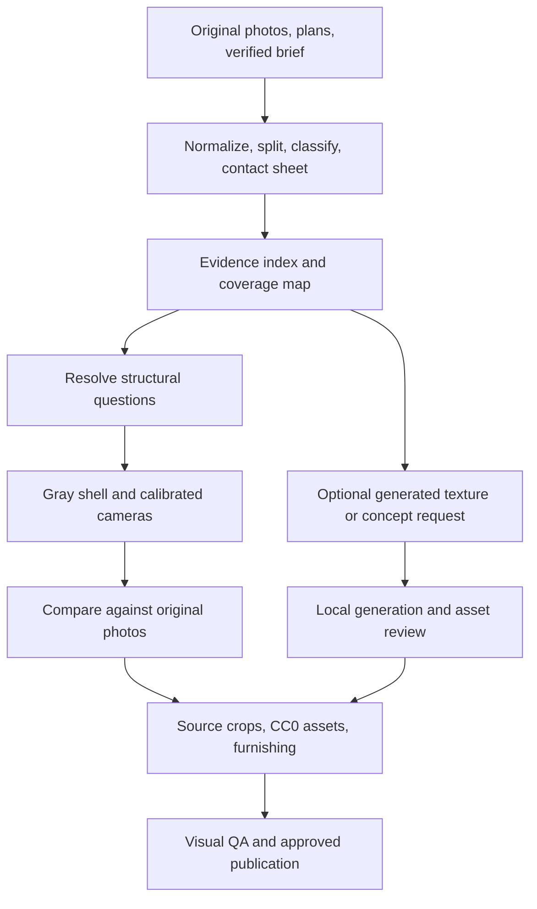

# Image-to-property pipeline: clarity, fidelity, and free AI options

Reviewed: 2 November 2026. Companion to [the consumer production review](production-real-estate-review.md).

Main entry point: [Combined product review, competitor research, and priorities](README.md).

## Recommendation

Build an evidence-first pipeline with an optional generation stage. Preserve original images, record exactly what each image establishes, reconstruct the supported geometry, then use AI selectively for appearance assets or explicitly labeled concept variants. Missing property information stays missing until there is supporting evidence.

For now, target **no paid API calls**: local image preprocessing, existing procedural rendering and CC0 assets, plus optional local generation on suitable hardware. Generate assets during authoring and serve approved static outputs to consumers. Consumer visits should not need a generator, API key, or free-tier quota.

This review proposes changes; it does not install models, upload property images, change conversion instructions, or integrate a provider. Actual generation speed and memory requirements remain unbenchmarked. The environment reports ARM64; chip model and available RAM could not be read, so local model suitability is not established.

## What was inspected

- `.claude/skills/convert-house/SKILL.md` and its directly referenced `.ai-workflow/contracts/house-conversion-runbook.md`.
- `houses/dubai-1br-sample/work/photo-index.json`, its conversion report, source collage, and saved `shots/01a.png`.
- `scripts/house-preview.ts`, `scripts/house-validate.ts`, `src/domain/validator.ts`, and targeted generated-asset/model entries in `scripts/fetch-assets.ts` and `src/viewer/furniture/Furniture.tsx`.
- Current official documentation for the free/local tool options linked below.

The saved screenshot is historical evidence, not a newly reproduced capture of the current app. The exterior and interior samples remain independent properties.

## Existing pipeline: strengths and gaps

The current flow already has useful separation: image intake → photo index → topology → shell validation → furnishing → source-texture crops/models → photo-match screenshots → report. Keep this structure and make its evidence and stage outputs more explicit.

| Current behavior | Why it affects clarity/fidelity | Proposed refinement |
| --- | --- | --- |
| “View every image exactly once,” then rely on text descriptions | Small structural details and contradictions can be lost in the initial summary | One initial pass, then targeted reinspection for unresolved claims and QA; record which evidence resolved each question |
| Descriptive photo index with approximate scale and directions | Observations, guesses, and measurements occupy the same narrative | Separate observed features, inferred relationships, measured values, and unresolved questions |
| Unseen rooms receive default dimensions | An unseen bathroom can become a convincing but unsupported room | Defaults may support a labeled draft; consumer publication needs explicit treatment of unsupported rooms |
| Scale whole shell toward brief area | An area figure may include balconies/common allocation or use a different definition | Check the area definition before scaling; use actual dimensions first and record residual disagreement |
| Collage splitting and texture crops | Crop lineage, transforms, and output dimensions are not centrally modeled | Track source hash, parent panel, crop bounds, perspective transform, and purpose |
| Every reference photo requires a camera | Detail crops or plan images do not necessarily describe a usable scene viewpoint | Classify image roles; require cameras for scene references, coverage for other evidence types |
| Shell freezes after geometry validation | Valid polygons do not establish that the room arrangement matches photographs | Add a gray-shell camera comparison before furnishing |
| Fixed wait before screenshots | Elapsed time does not establish all assets are loaded | Capture after explicit scene readiness; keep timeout/failure status with the capture |
| Coarse image-match checklist and three-iteration cap | A screenshot can exist even while a material structural mismatch remains | Record alignment and semantic checks; the iteration cap ends automated work, not the need to resolve publication blockers |
| Warm lighting and real skyline HDRI are house-wide preferences | Artistic light can obscure color matching; an unrelated skyline can imply a real view | Use a neutral QA preset and separate presentation preset; distinguish illustrative background from verified view |

The runbook also describes clearance and door-swing checks as part of validation. The inspected `HouseValidator` checks room/item containment, overlaps, materials and other content rules, but does not visibly implement explicit door-swing or minimum-walkway clearance checks. Mark those manual until implemented; do not let documentation imply that a green CLI result proves them.

### Concrete sample finding

The source collage's first panel prominently shows balcony glazing and a neighboring building. In the saved `01a` render, a large wall dominates that area and the glazing is mostly obscured. Camera calibration and room topology need review before spending effort on finer plants, flowers, or generated textures. This is a saved-image comparison; it is not proof of the current live rendering.

The conversion report also records conflicting staging and an inferred bathroom. The index is useful because it exposes those questions, but the publication process must preserve that uncertainty rather than resolving it through a plausible generated image.

## Proposed stages and concrete outputs



Generated outputs never become new source evidence for `D` or `E`.

### 1. Intake: make the image set understandable

Keep `refs/` immutable. Create working derivatives under `work/` and final approved runtime assets under the property's public asset folder.

- Check orientation, pixel dimensions, corrupt files, duplicate/near-duplicate views, blur and severe clipping. Preserve originals; normalize orientation and color handling on derivatives.
- Create a labeled contact sheet so the operator can understand the whole set quickly. Split collages with recorded panel coordinates and parent IDs.
- Classify each input: interior scene, exterior scene, material/detail, floor plan, survey/site plan, or illustrative marketing render. A marketing render is not proof that construction or amenities exist.
- Group by property and capture/staging session. Confirm grouping before combining similar-looking rooms from different listings.
- Use a reduced-size image for overview, then original-resolution crops for windows, doorways, tile joints, signage, or other disputed details. Upscaling is not a substitute for evidence absent in the source.

**Output:** source manifest, labeled contact sheet, derivatives, and an intake report listing missing or unusable evidence.

### 2. Evidence: attach claims to image regions

Extend the photo index rather than discarding it. Give claims IDs and link them to image regions and scene elements. A compact record could look like:

```json
{
  "id": "living-glazing-location",
  "sources": [{ "imageId": "01a", "regionXYWH": [0.54, 0.19, 0.25, 0.48] }],
  "status": "observed",
  "confidence": "medium",
  "statement": "Glazing visible behind the seating area",
  "sceneElementIds": ["w-living"],
  "openQuestion": "Confirm wall orientation using another view or plan"
}
```

Coordinates above illustrate a normalized top-left `x,y,width,height` format, not measured annotations of the sample. Define that format once. Keep confidence descriptive; it is an assessment, not a calibrated probability.

Add a coverage table: room/feature → supporting images → dimensions source → blind spots → conflicts. Separate a plausible door-height prior from a supplied measured dimension. Do not interpret an agent-assigned N/E direction as verified compass orientation.

**Gate:** every structural element has evidence or an explicit inferred/unknown status. Contradictory structure stays unresolved until confirmed or excluded from the factual tour.

### 3. Geometry: verify a simple scene before decorating

Produce a neutral gray shell with rooms, openings, and coarse furniture anchors. Calibrate camera position, height, aspect ratio and FOV against source landmarks; consider source distortion where visible. Do not move walls merely to compensate for a wrong camera.

Compare doorway corners, glazing edges, ceiling steps and shared objects across views. Use side-by-side and opacity-overlay comparisons at the same aspect ratio. Optional normalized landmark reprojection errors can help rank misalignment, but matching a single view cannot prove the whole 3D layout.

Record a versioned camera calibration. Changing topology invalidates affected room placement, cameras and captures; changing one texture should not restart topology.

**Gate:** structurally important discrepancies are resolved or explicitly accepted as limitations. Unsupported geometry cannot be made verified by passing schema checks.

### 4. Appearance: use the cheapest faithful source

For each asset, use this order:

1. Suitable original photo crop, with perspective correction when justified and with recorded lineage.
2. Existing procedural asset or a fitting CC0 texture/model.
3. Optional generated generic appearance asset or labeled staging concept.
4. An honest placeholder if none of the above is suitable.

Flat artwork can often be rectified with a four-corner transform. Folded cushions or curved objects cannot be accurately flattened by applying that same transform indiscriminately. Avoid baking photo shadows/highlights into materials that will receive scene lighting again.

Keep material appearance and geometry separate. An AI-generated RGB image is not automatically a correct set of normal, roughness and metallic maps. Begin with tested material settings; only introduce derived PBR maps when their visual behavior has been checked.

### 5. QA: show exactly what passed

Build a per-property review sheet with source, matching render, overlay, labeled evidence, and unresolved issues. Capture neutral lighting for fidelity checks and presentation lighting for consumer appearance. Render navigation thumbnails/posters directly from the approved scene for viewpoint consistency.

Require scene-ready status, no asset-load errors, a recorded scene revision, camera revision, viewport, and quality tier. Compare multiple viewpoints and perform a separate walkthrough/collision check. Inspect generated assets from different angles and in target lighting.

Use separate statuses: `geometry-valid`, `visual-review-needed`, `source-conflict`, `approved-illustrative`, and `approved-for-publication`. A maximum retry count should produce an unresolved review item, not an automatic pass.

## Where AI image generation helps

| Use | Suitable approach | Consumer treatment |
| --- | --- | --- |
| Generic fabric, plaster, wood or rug appearance when no source crop works | Generate flat, evenly lit candidates; inspect seams and lighting in the scene | Generic/approximate material, not a claim of the property's exact finish |
| Alternative furnishing/color concept | Condition on the approved scene render, with suitable depth/edge/mask tools when available | Separate “Design idea / virtual staging” view with access to the original |
| Small masked decorative texture repair | Edit a derived texture; retain the original and inspect changed pixels | Preserve provenance; reject edits that fabricate a property fact |
| Abstract decorative artwork for a fictional sample | Generate an original image matching the sample's palette | Illustrative decoration |
| Accurate property cover, thumbnails and share posters | Render from the approved 3D scene or use the real photo; generation usually adds little | Label reconstructed media appropriately |
| Missing bathroom, rear facade, actual skyline, amenities or boundaries | Request additional evidence or leave unknown | Never promote generated content to factual evidence |

For towers, generate generic surface detail only when it does not alter meaningful facade facts. For land, keep boundaries, access and neighboring features tied to survey/map evidence. For interiors, generating an attractive complete room will usually introduce more unsupported details than generating a small decorative texture.

Prompt example for a generic candidate: “Flat orthographic swatch of muted gray woven upholstery, even diffuse lighting, no objects, no perspective, no cast shadow, no text.” Requesting seamless output is only a prompt; verify tiling by repeating the image and inspect it on actual geometry.

## Free options and their limits

“Free” here means no model/API fee for the selected local workflow, subject to the model's terms. Existing hardware, power, downloads, disk space and operator time still have costs. Free software does not make hosted GPU inference free.

| Option | Fit for this project | Important limit |
| --- | --- | --- |
| Existing crop/resize/render workflow and Poly Haven | Default for exact photo-derived appearance, generic materials, models and lighting assets | Use assets that fit; do not mistake an unrelated HDRI for a verified property view. Poly Haven publishes its assets under CC0. [Source](https://polyhaven.com/license) |
| Local FLUX.1-schnell | Initial candidate for generic decorative images; official model card permits commercial use under Apache 2.0 | Hardware feasibility and quality need a local trial; checkpoint access may require accepting repository conditions. This is a text-to-image candidate, not a complete inpainting workflow. [Source](https://huggingface.co/black-forest-labs/FLUX.1-schnell) |
| MFLUX on a compatible Apple Silicon machine | CLI-based local runner with quantization and metadata export; useful for a small authoring adapter | Supported features vary by exact model; runner support does not establish that a checkpoint or workflow fits available memory. [Source](https://github.com/mflux-community/mflux) |
| Local ComfyUI | Saved workflows and API integration if masked editing/conditioning becomes necessary | More workflow/dependency maintenance; model and node compatibility must be checked separately. Apple Silicon installation is documented. [Source](https://github.com/Comfy-Org/ComfyUI) |
| Hugging Face ZeroGPU Spaces | Occasional experiments when local generation is unsuitable | Free usage is quota-limited and queued. Treat as optional authoring assistance, not reliable production capacity. No fixed daily quota is assumed here. [Source](https://huggingface.co/docs/hub/en/spaces-zerogpu) |
| Existing TRELLIS path | Optional single-object mesh generation, already referenced for the sample bed | This is image-to-3D, not image generation. Official local setup requires Linux/NVIDIA with at least 16 GB GPU memory; do not assume a native Mac installation. Hosted quotas and each chosen service still matter. [Source](https://github.com/microsoft/TRELLIS) |

My suggested first trial is **one local runner and one generic texture task**, while keeping the original crop/CC0/procedural path as the default. Pick MFLUX if the actual Mac hardware is suitable and CLI operation is preferred; use ComfyUI when a reviewed workflow needs its graph/API. Do not install both merely to cover hypothetical future requirements.

License tracking must distinguish model/checkpoint terms, runner terms, source-image rights, and generated-output provenance. A “TRELLIS (MIT)” annotation describes the tool and does not independently establish rights to every source photo or generated object. Record adapters/LoRAs separately if added.

## How to integrate without introducing a consumer runtime dependency

Start with an authoring command, not a public generation endpoint. Proposed stages/commands below are design sketches and do not currently exist:

| Proposed operation | Responsibility |
| --- | --- |
| `images:prepare <slug>` | Validate inputs, produce manifest/contact sheet and derivatives |
| `images:audit <slug>` | Report coverage, conflicts and missing provenance |
| `assets:generate <request-id>` | Run an explicit optional local generation request |
| `images:compare <slug>` | Capture ready scene views and assemble comparison sheets |

Keep TypeScript orchestration in the existing script style. Isolate generation behind an adapter: disabled/default mode, local CLI mode, and a local ComfyUI mode if needed. A separate Python environment can own model dependencies. Use structured subprocess arguments and explicit paths. The website consumes approved files only.

ComfyUI exposes queue/prompt/history routes suitable for an authoring adapter; use a saved workflow and track job completion rather than depending on a fixed sleep. [Official server routes](https://docs.comfy.org/development/comfyui-server/comms_routes)

Each generation request should record:

- Property ID, purpose, affected asset/scene IDs, source IDs and hashes, and whether it is generic decoration or a concept variant.
- Runner version, checkpoint/revision/hash, relevant licenses, workflow hash, prompt, seed, dimensions, and settings.
- Input image/mask/conditioning hashes when used; output hash, path and label; reviewer decision and rejection reason.

Use a cache key from the request and versioned inputs. Fixed seeds help track experiments but do not guarantee identical outputs across hardware/runtime changes; store the actual approved output. Generate a small bounded number of candidates, reuse accepted outputs, and fail back to existing assets when generation is unavailable.

Keep originals in `refs/`, evidence and intermediate requests under `work/`, and only approved optimized assets in the public folder. Strip private metadata from published copies. Public hosted experiments involving property photos need the property's upload authorization; local generation avoids that upload dependency. Never silently switch to a paid provider or paid credits when a free job fails.

## Implementation order

1. **Clarify existing instructions first:** allow targeted image reinspection, separate measured/inferred claims, correct claims about validator coverage, and distinguish QA lighting from presentation styling.
2. **Add free deterministic tooling:** source manifest/contact sheet, image roles and coverage, source-to-render comparison sheets, explicit readiness and review status. No generative model needed for this improvement.
3. **Pilot optional local generation:** benchmark a few generic fabric/decorative textures, document memory/time and visual quality, accept or reject candidates in-scene. Expand only if they outperform existing crops/CC0 assets for that task.
4. **Add staged variants later:** separate concept media and guided review for any image edits, depth/edge conditioning or generated meshes. Keep the factual model and its evidence independently accessible.

First pilot: revisit the sample's glazing/topology and cameras, produce an evidence-backed shell comparison, then test one generic texture. Successful acceptance means the structural mismatch is addressed or clearly documented, source evidence remains intact, the generated asset is traceable, and consumers can load the result with no generation service running.
